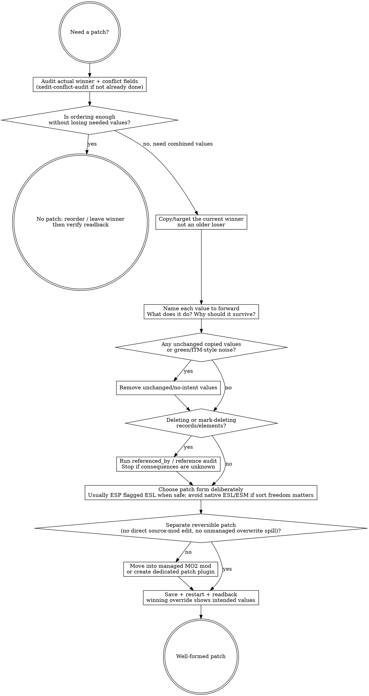

# xEdit Automation — Hub Skill

This skill is the always-loaded entry point for any xEdit work. It is the single source of truth for "which path do I use" and "what must I never do." Specialised task skills (e.g. `xedit-conflict-audit`) inherit its routing, anti-patterns, and verification discipline; they do not restate them.

## Toolbox at a glance (progressive disclosure, r6-aware)

The forked xEdit daemon is best treated as a progressive-disclosure surface:
start with the small MCP intent tools, ask the live daemon which r6 capability
blocks it supports, then switch to the richer one-call patterns only when the
corresponding `system.capabilities.supports.*` key is present.

- **Discovery & session** — `xedit_session`, `xedit_list_capabilities`. Call
  `xedit_session` first every conversation. Then call `xedit_list_capabilities`
  once to see the command digest, `contractVersionExpected`, and r6
  `supports.*` anchors.
- **Reading records & conflicts** — `xedit_find_record`, `xedit_read_record`,
  `xedit_inspect_conflicts`. These are the W2 (conflict audit) backbone; branch
  to atomic passthrough when W2 needs an r6 response block that no intent tool
  exposes yet.
- **Atomic passthrough** — `xedit_call(command, args)`. For any native daemon
  command that does not have an intent tool yet. Still runs the full pipeline
  (validation → state → rules → audit). Use it whenever the intent tools do not
  fit.

For deep reference material, query the structured BGS KB first (`bgs_kb_query`
/ `bgs_kb_get`). Deep reference records live under
`knowledge/bgs-kb/packs/core/records/xedit/` (queryable via `bgs_kb_query` /
`bgs_kb_get`).

## Routing doctrine (which path to use)

| Task shape | Path |
|---|---|
| High-frequency known intent (audit a conflict, read a record, run a job, write a patch) | **MCP intent tool** |
| Novel / debugging / free composition of native commands | **MCP atomic passthrough**: `xedit_call(command, args)` — still in harness |
| Exploratory atomic-op storm (trial-and-error, repeated read-eval, hypothesis testing) | **Delegate to a read-only investigator sub-agent** with this skill loaded; the sub-agent burns its own context, returns a distilled summary |
| Large formalisable bulk mutation | **MCP `xedit_run_script`** (Batch 4+) with dry-run + snapshot |
| Daemon explicitly in default (non-MCP) mode, manual debug only | Direct `xedit-client.ps1` is acceptable — but ONLY when the user has explicitly accepted the risk and the daemon is not in `-automation-mcp-mode` |

**The agent should never have a reason to bypass the MCP.** Atomic passthrough exists for that.

## 补丁创作判断 / Patch authoring judgment

### Overview

Patch authoring is not "make the red go away." It is a small compatibility
argument: preserve the current winner, forward only the upstream values that
should still survive, and leave behind a reversible patch plugin whose contents
say what you meant. Sorting is a single-choice lever; patching is how you keep
two mods' intended values active at once. But true-in-principle is not
true-at-pack-scale: if the plan is to stitch every FormID because "xEdit can fix
anything," the plan is already broken.

Use this section when you are about to author or judge a patch through the MCP.
Use `xedit-conflict-audit` first when the question is still "what wins, what
conflicts, and should this be patch-vs-reorder?" That skill owns the
patch-vs-reorder call; this section owns whether the patch you are about to
write is well-formed.

### Decision flow: is this patch well-formed?



### Authoring checks

- **Forward the winner.** The game reads the final/winning override for a
  FormID. Build the patch from the current winner, then forward only the older
  mod values that still need to survive.
- **No unchanged cargo.** If a copied value does not change meaning, it is
  ITM-style noise, not compatibility. Remove it unless you can state why it is
  intentionally carried.
- **Patch as separate layer.** Do not drag values directly into the source mod
  just because it is the rightmost column today. A patch should be reversible by
  disabling/removing the patch layer, not by hand-deleting fields from someone
  else's plugin.
- **Preserve references.** If deletion or mark-delete enters the plan, stop and
  run the referenced-by/readback path first. Unknown references mean unknown
  blast radius.
- **Choose plugin form deliberately.** Ordinary compatibility patches usually
  want normal ESP sort freedom plus ESL flagging when safe. Native ESL/ESM
  load-order behavior is not a free cleanliness upgrade.
- **Good patch vs band-aid patch.** A good patch has named intent per forwarded
  value and reduces conflict debt. A band-aid patch copies whole records, edits
  source mods, or tries to stitch every FormID because sorting was treated as
  irrelevant.

### KB query discipline

This judgment section is game-agnostic. Query KB for game-specific patching
gotchas, record-family caveats, and current toolchain facts rather than
fossilizing them here.

```text
bgs_kb_query({ query: "xedit patch authoring gotchas", domains: ["xedit", "load-order"], games: ["<current game>"] })
```

If KB is silent, mark `[GAP]` and keep the patching rule at the framework level
instead of inventing a game-specific doctrine.

### Red Flags (STOP)

| Thought | Reality |
|---|---|
| "It's red, so copy the left value." | Red is a prompt to inspect. It is not a verdict that the losing value should survive. |
| "The rightmost mod is wrong; I'll edit it directly." | Then you made the source mod the patch. Use a separate override patch so reversal is clean. |
| "Sorting does not matter because xEdit can patch anything." | In principle, yes; across hundreds of thousands of FormIDs, no. Use ordering to reduce repair debt, then patch the meaningful remainder. |
| "Green/unchanged copied values are harmless." | They are no-intent cargo. If they do not change meaning, remove them. |
| "Native ESL is cleaner than ESP flagged ESL." | Native ESL/ESM can cost normal sort freedom. Use ESP flagged ESL when that is the safe patch shape. |
| "This looks unused; delete it." | Referenced-by first. Deletion without reference knowledge is unknown blast radius. |

### Rationalizations

| Excuse | Reality |
|---|---|
| "I'll just drag one field into the winning plugin." | One field is still a source-mod edit. Make a patch layer, or future-you hand-removes stray fields one by one. |
| "The patch should preserve everything any mod touched." | Preserve intent, not history. Some edits are core to the mod; some are incidental author preference that should lose to a systemic rule. |
| "I do not know what this field does, so I'll copy the version that looks plausible." | Unknown field meaning is a research task, not a dice roll. Read the record structure, CK/wiki/community examples, and actual in-pack behavior. |
| "Overwrite is fine; MO2 sees it." | Overwrite is spill. A real patch belongs in a managed mod layer with a name future-you can understand. |
| "The response said ok; the patch is done." | Patch acceptance is winning-override readback after save/restart, with the intended values visible and no unintended cargo. |

## R6 progressive-disclosure capability checks

Do not assume every daemon is r6. Read `xedit_list_capabilities` once and branch
on the support keys below. On pre-r6 daemons, fall back to the older explicit
record-list / child-walk / per-record loop patterns; on r6+ daemons, use the
one-call or page-aware form to reduce round-trips and preserve context.

| Capability key | Contract | Prefer this pattern | KB record |
|---|---:|---|---|
| `supports.childGroupNavigation` | 0.13 | Navigate CELL/WRLD/DIAL/QUST ChildGroups through `elements.children` stubs | `xedit.childgroup-navigation.v1` |
| `supports.createParentSpec` | 0.16 / 0.18 | Create records directly under parent ChildGroups with `records.create` `parent` | `xedit.records-create-parent-spec.v1` |
| `supports.elementsChildrenPagination` | 0.17 | Page `elements.children` with `limit` / `offset` | `xedit.elements-children-pagination.v1` |
| `supports.reverseNavigation` | 0.19 | Add `includeParents:true` and read `relations.parents` | `xedit.reverse-navigation.v1` |

For the whole r6 contract delta, query KB record `xedit.r6-contract-summary.v1`.

### ChildGroup navigation (`supports.childGroupNavigation`)

On r6+ daemons, `elements.children` on CELL, WRLD, DIAL, and QUST records
returns a virtual child entry with `kind: "child_group"`. Treat that entry as a
read-only navigation stub, not as a real mutable element.

Use it one generation at a time:

```text
elements.children({ file, formId, path: "\\Child Group" })
elements.children({ file, formId, path: "\\Child Group\\Persistent" })
elements.children({ file, formId, path: "\\Child Group\\Temporary" })
elements.children({ file, formId, path: "\\Child Group\\Visible when Distant" })
elements.children({ file, formId, path: "\\Child Group\\Block X, Y" })
elements.children({ file, formId, path: "\\Child Group\\Block X, Y\\Sub-Block M, N" })
```

- Walk exactly the next level; do not ask for the whole tree when a page or one
  ChildGroup label is enough.
- The `\\Child Group...` paths are synthetic and READ-ONLY. Mutation verbs must
  use flat FormID locators (`{ file, formId }`) or a `records.create.parent`
  spec; do not pass synthetic locator paths to mutators.
- For WRLD cells, use `Persistent` or the Block/Sub-Block/coordinate route
  depending on the target child group.
- Deep reference: `xedit.childgroup-navigation.v1`.

### `elements.children` pagination (`supports.elementsChildrenPagination`)

On r6+ daemons, `elements.children` accepts `limit` and `offset`:

```text
elements.children({ file, formId, path, limit: 200, offset: 0 })
```

- `limit` is clamped to 1-1000 and defaults to 200.
- Responses include `count`, `total`, `offset`, and `truncated`.
- If `truncated` is true, keep the same `limit`, add `count` to `offset`, and
  fetch the next page until covered.
- Do not assume CELL child groups are small: FO4 vanilla CELL `00000025`
  `Temporary` contains 742 records.
- Deep reference: `xedit.elements-children-pagination.v1`.

### Reverse navigation (`supports.reverseNavigation`)

On r6+ daemons, add `includeParents: true` when you need to know ownership or
containment without a second verb. Supported read calls include:

- `records.get`
- `records.find_by_form_id` / `records.find_by_editor_id` and MCP wrappers such
  as `xedit_find_record`
- `records.master_or_self`
- `records.winning_override`
- `elements.get`
- `elements.children`

The response may include:

```text
relations.parents: [{ locator, object }, ...]
```

Parents are nearest-first with a daemon depth cap of 16. This is the preferred
answer to "which CELL owns this REFR?" or "which QUST/DIAL group contains this
child?" Use the parent chain as readback evidence; do not build a custom
reverse-index loop unless the support key is absent. Deep reference:
`xedit.reverse-navigation.v1`.

### `records.create` parent-spec (`supports.createParentSpec`)

Mutating record creation into ChildGroups is r6-gated and still requires the
normal MCP mutation consent path. When supported, author the target parent
explicitly instead of trying to mutate synthetic `\\Child Group` paths.

CELL, DIAL, and QUST children:

```text
records.create({
  targetFile,
  signature,
  editorId,
  parent: { file, formId, subGroup? }
})
```

WRLD children:

```text
records.create({
  targetFile,
  signature,
  editorId,
  parent: { file, formId, subGroup: "Persistent" }
})

records.create({
  targetFile,
  signature,
  editorId,
  parent: { file, formId, coords: [X, Y] }
})
```

For `coords`, native xEdit creates the needed Block/Sub-Block groups. Validate
with `records.get` or `elements.children({ includeParents: true })` after the
preview/commit flow, and remember that durability still requires save + daemon
restart + readback. Deep reference: `xedit.records-create-parent-spec.v1`.

## Pascal scripting constraints (fork-specific runtime)

The forked xEdit daemon's Pascal interpreter (JvInterpreter) is more constrained
than standard xEdit. When authoring scripts through `scripts.write` +
`scripts.run`, these constraints apply:

### Hard-denied symbols (runtime policy)

| Symbol | Denial | Workaround |
|---|---|---|
| `TStringList` / `TStringList.Add` | Runtime policy deny-default | Use `AddMessage()` for line-by-line output |
| `TStringList.Create` | Runtime policy deny-default | Same — output directly |
| `TFileStream` / filesystem writes | Denied (constrained runtime) | Output via `AddMessage()` only |

### Undeclared identifiers (not in JvI ledger)

| Identifier | Status | Workaround |
|---|---|---|
| `GetTickCount` | Undeclared | Use `Now` with `* 86400` for second-precision timing |
| `ConflictThisForMainRecord` | Undeclared in this fork | Use `xedit_call records.conflict_status` through atomic passthrough or `xedit_inspect_conflicts` instead |
| `ConflictAllForMainRecord` | Undeclared in this fork | Same — use daemon-native conflict commands, not Pascal functions |

### Syntax requirements

| Requirement | Detail |
|---|---|
| `unit` not `program` | Scripts must start with `unit <Name>;` — `program` is rejected |
| `Initialize: Integer` | Entry point is `function Initialize: Integer;` returning 0 |
| `AddMessage()` | Only output channel available; no `WriteLn`, no filesystem write |

### Consent requirement

`scripts.write` is classified as a **mutating** command (Agent namespace write)
and requires the daemon to be launched with `iKnowWhatImDoing: true`. Without
consent, it fast-fails with `consent_required`. `scripts.run` on an existing
script does NOT require consent.

### Recommended alternative for broad surveys

For bulk conflict/record surveys (heatmaps, per-plugin stats), prefer
`records.list` + `xedit_inspect_conflicts` on targeted plugins over a Pascal
script. The constrained runtime makes iteration slow and fragile. Use Pascal
scripts only for well-defined batch mutations, never for exploratory analysis.

### Pitfall: Large WRLD conflict_status response crashes the MCP server

**Symptom**: Calling `records.conflict_status` on Tamriel (0000003C) or other
worldspaces with 100K+ child records causes the MCP server to become unreachable
(`ClosedResourceError`). All subsequent xEdit MCP tools fail.

**Root cause**: The daemon response for massive childGroup blocks (325K+ children
in Tamriel) overflows the MCP's transport buffer or Node.js memory, killing the
server process. The daemon itself survives — `xedit_status` still shows
`ready` after the MCP reconnects.

**Prevention — use the childGroup summary block**: `records.conflict_status`
returns a `childGroup` field with per-signature aggregate counts (e.g. CELL:
5710/11187 conflicting, REFR: 37792/284482). This is the right signal for broad
audits. Read the `childGroup.count`, `childGroup.signatures.*.total/conflicting`,
and the capped `conflictingHits` array (max 20) — do NOT expand every child.

**Recovery when MCP crashes**: Wait for the cooldown (~55s after 3 consecutive
failures), then call `xedit_status` to confirm daemon is still `ready`, then
`xedit_session` to rebuild the session context. The daemon does NOT need restart.

**Counter-pattern that triggers this**: iterating every child of a CELL/WRLD
group manually. Always prefer the summary block + targeted samples over
depth-first expansion of worldspace children.

## Anti-patterns (hard bans)

Never do any of the following. Each ban is encoded as an MCP rule or daemon-side refusal, but the skill states them so the agent does not even attempt:

1. **Do not write Python (or any other language) to parse `.esp/.esm/.esl` files directly.** The daemon is the only correct path. If you find yourself reaching for a binary plugin parser, stop and use `xedit_call` instead.
2. **Do not trust an `ok: true` response as durability.** A save with `pendingShutdown > 0` is deferred; durability requires a daemon restart and readback (see §10 of the design spec).
3. **Do not call mutating ops in mcp-mode without going through the MCP.** Direct pipe writes will be refused by the daemon with `mcp_mode_required`.
4. **Do not page `system.capabilities` every session.** The digest in `xedit_list_capabilities` already carries the curated map; only call live capabilities once to check drift.
5. **Do not delete or mark-deleted a record that is referenced by other plugins** without first calling `xedit_call records.referenced_by` and accepting the consequences. Snapshot does not cleanly recover deletions.

## Enabling consent (`-IKnowWhatImDoing`)

Mutating intent tools (`xedit_create_child_record`, `xedit_call records.create`,
`xedit_call records.delete`, `xedit_call records.copy_into`, etc.) require the
xEdit daemon to be launched in consent mode — otherwise they fast-fail with
`code: "mutation_requires_iknowwhatimdoing"` BEFORE the daemon is contacted.

Enable consent at launch time via the MCP arg:

```
xedit_start({ iKnowWhatImDoing: true, ...other overrides })
xedit_restart({ iKnowWhatImDoing: true, ...other overrides })  # if already running
```

The flag is forwarded as `--i-know-what-im-doing 1` to `xedit-client.ps1`, which
appends `-IKnowWhatImDoing` to xEdit's startup argv. Verify post-launch:

```
xedit_session()  # data.consentEnabled === true ?
```

If `consentEnabled` is still `false` after passing `iKnowWhatImDoing: true`,
the flag did not propagate — check that the MCP is on a build that includes
the consent forwarding (commit `xxx` and later; see `RELEASE-NOTES.md`).

Consent is per-launch and explicit only: there is no env-var fallback, no
runtime toggle, and the audit log captures the consent decision at the call
site. To revoke consent, call `xedit_stop` then `xedit_start` without the flag.

## Confidence + dry-run discipline (borrowed from skyrimvr-claude-toolkit)

Before any mutating action:

1. State your confidence (0-100%) and your top 3 assumptions.
2. If confidence < 90%, investigate first (read records, inspect conflicts, list references) until ≥ 90%.
3. For HIGH-RISK mutations, the MCP will return a preview envelope with `confirmToken`. Read the preview, decide, then commit with the token. Treat the preview as the contract.

## Sub-agent delegation recipes (role-agnostic)

When delegating, do not hard-code role names — the harness will map them. Use these recipes:

**Read-only investigator** — for exploratory storms, conflict surveys, and "what's in this plugin" reconnaissance:

> Dispatch a read-only investigator sub-agent with this skill loaded. Provide the question, the target files, and the budget (token / time / step count). The sub-agent should return a distilled summary (verdict + key evidence + open questions), not the raw daemon round-trips.

**Bounded mutation worker** — for well-defined batch edits (Batch 4+):

> Dispatch a bounded-execution sub-agent with this skill and the patch-authoring skill loaded. Provide the spec, the snapshot expectations, and the acceptance checks. The sub-agent should perform the mutations through the MCP and return the snapshot IDs + readback proof.

## Self-growing knowledgebase

After any session that produced a footgun (an unexpected refusal, a non-obvious recovery, a surprising daemon behavior):

1. Identify whether the gotcha is a durable fact, not project-internal noise. Project-local lessons that do not belong in the public KB go in the project devlog instead.
2. Author a KB record at `<pack-root>/records/<domain>/<slug>.v1.md` with YAML frontmatter that validates against `knowledge/bgs-kb/schema/record.schema.json`.
3. Pick the pack deliberately: cross-game / cross-tool facts go under `knowledge/bgs-kb/packs/core/records/`; game-specific facts go into the matching per-game pack (`bgs-kb-skyrim`, `bgs-kb-fallout4`, `bgs-kb-fallout3-fnv`, `bgs-kb-starfield`).
4. Run `node tools/bgs-kb-mcp/dist/cli.js validate <pack-root>` and then `node tools/bgs-kb-mcp/dist/cli.js build <pack-root>` to refresh that pack, unless the current phase explicitly forbids rebuilds and gives a narrower validation path.
5. Verify retrieval from a fresh MCP connection with `bgs_kb_query` and confirm the new record appears for a query a future agent would actually use.
6. If the footgun is mechanically detectable, mark the KB record as a rule candidate when the schema supports it and track the reserved rule ID in a planning doc. Candidates require human review before promotion into `tools/xedit-mcp` enforcement.

Worked example:

1. Gotcha: xEdit daemon responses may include `0x`-prefixed FormIDs, while the MCP normalizes them at the edge.
2. Pack/path: `knowledge/bgs-kb/packs/core/records/xedit/formid-prefix-normalization.v1.md`.
3. Validate/build: `node tools/bgs-kb-mcp/dist/cli.js validate knowledge/bgs-kb/packs/core` then `node tools/bgs-kb-mcp/dist/cli.js build knowledge/bgs-kb/packs/core`.
4. Verify: query `bgs_kb_query({ query: "0x FormID normalization", domains: ["xedit"] })` and confirm the record is returned.

## When this skill applies

- Any task involving Bethesda plugin files (`.esp/.esm/.esl`) for FO4, Skyrim, FO76, Starfield in this repo's MO2 harness.
- Any conflict / patching / cleaning / ESL / scripting task against xEdit.
- Whenever the task description names xEdit, plugin records, FormIDs, masters, conflicts, ITM/UDR, ESL flagging, or Pascal Edit Scripts.

When in doubt, load it.

## Non-plugin asset analysis

For NIF mesh conflicts (texture references, block-type comparison, collision
presence, skeleton counts), see `references/nif-binary-analysis.md` for the
binary scanning pattern. MO2 VFS tools (`mo2_assets_conflicts`,
`mo2_assets_resolve`) handle file-level NIF conflict detection.

## Sibling skills

- **`writing-bgs-load-order`** — authoritative reference for editing
  `plugins.txt` / `loadorder.txt`. Use it whenever the task is about
  activating, deactivating, reordering, adding, or removing plugins from the
  load order. Do NOT edit `plugins.txt` blindly; xEdit can not change load
  order itself (docs 2.3), so the file edit is the only path for those
  operations, and the asterisk-format rules + official-master detection rules
  are non-obvious.
- **`setting-up-bgs-modding-environment`** — first-run setup including the
  MO2 `gamePath` inspection step you must do before launching xEdit with the
  `dataPath` override.

## Launching xEdit with explicit args (NEW)
## Launching xEdit with explicit args

The `xedit_start` MCP tool accepts optional overrides:

```
xedit_start({
  launcherPath?:    string,  // xEdit.exe path; default <moRoot>/tools/xEdit/xEdit.exe
  gameMode?:        string,  // "Fallout4", "SkyrimSE", "Starfield"
  dataPath?:        string,  // -D: flag; MO2 <gamePath>\\Data
  pluginsFile?:     string,  // -P: flag; agent-authored plugins.txt (bypasses profile lookup)
  moProfile?:       string,  // MO2 profile name; defaults to env
  moRoot?:          string,  // MO2 base install root (plugins, tools, control plane)
  mo2InstanceRoot?: string,  // MO2 instance root for split layouts (profiles, mods)
})
```

**`moRoot`** — the MO2 base install directory containing `plugins/Mo2AgentControl/`,
`ModOrganizer.exe`, and `tools/xEdit/`. Defaults to `$env:BGS_MO2_ROOT`.

**`mo2InstanceRoot`** — split-layout override for the instance directory containing
`profiles/<name>/plugins.txt` and `mods/`. When set, profile/plugin resolution uses
this path while `moRoot` still drives the control-plane bridge. Omit for
single-directory layouts.
```

**Always pass `dataPath`** when the user wants xEdit to see the MO2-managed
game tree. Without it, xEdit falls back to the Windows registry, which
returns the raw Steam install path — and your conflict audit will be against
the wrong game data. Read MO2's `ModOrganizer.ini` `gamePath` value, append
`\\Data`, and pass that.

For load-order experimentation (test a subset of plugins to isolate a
conflict, or rehearse a sort), generate a plugins.txt under an
**agent-owned artifacts path** per `writing-bgs-load-order` and pass it as
`pluginsFile`.

### Split layout (multi-instance MO2)

MO2 supports a split layout where the base install (containing `plugins/`,
`Tools/xEdit/`, and `ModOrganizer.exe`) lives in one directory while an
**instance** (containing `profiles/`, `mods/`, `ModOrganizer.ini`) lives in
another. Detect it by checking `mo2_status` binding patterns — if `mo2_session`
fails against the base root (no `ModOrganizer.ini`) but succeeds against the
instance root, it's a split layout. In extreme cases (tri-split), the instance
INI is in `%LOCALAPPDATA%/ModOrganizer/<name>/`, the base_directory points to a
data path with profiles/mods, and the exe+plugins are in yet another path.

**The problem**: `xedit-client.ps1` uses `--mo2-root` for TWO different
purposes that diverge in a split layout:

| Purpose | Path in split layout |
|---|---|
| Find MO2 control-plane plugin (`plugins/Mo2AgentControl/bootstrap/runtime/`) | Base install root |
| Find MO2 profile (`profiles/<name>/plugins.txt`) | Instance root |

If `--mo2-root` points at the base install, the profile lookup fails and
xEdit falls back to registry detection — which may find the wrong game
(e.g. Fallout4 on a SkyrimSE install). If it points at the instance, the
control-plane launch fails because the plugin isn't there.

**Fix — `mo2InstanceRoot` parameter** (available in `xedit_start` and
`xedit_restart`): separates the two concerns. `moRoot` points at the base
install (plugins, tools), `mo2InstanceRoot` points at the instance
(profiles, mods):

```js
xedit_start({
  moRoot:           "<PATH_TO_MO2_INSTALL>",   // base: plugins + xEdit
  mo2InstanceRoot:  "<PATH_TO_MO2_INSTANCE>",                        // instance: profiles + mods
  launcherPath:     "<PATH_TO_MO2_INSTALL>\\Tools\\xEdit\\xEdit.exe",
  gameMode:         "SkyrimSE",
  moProfile:        "pbr",
  dataPath:         "<PATH_TO_STEAM_LIBRARY>\\steamapps\\common\\Skyrim Special Edition\\Data",
})
```

The parameter flows through: `xedit_start` → `launchDaemon` →
`xedit-client.ps1 --mo2-instance-root` → `$resolvedInstanceRoot` used for
profile/plugin resolution. `$resolvedSandboxRoot` (from `--mo2-root`)
continues to point at the control-plane bridge. When `mo2InstanceRoot` is
omitted, it falls back to `moRoot` (single-directory layout).

**Prerequisite — MO2 must be running**: The control plane serves live bootstrap
files (`status.json`, `endpoint.json`) that go stale when MO2 is closed. If
`xedit_start` returns `status: "failed"` with "Stale live bootstrap file",
start MO2 first. Check with `mo2_status.detection.process_running`. If
`mo2_run_tool` is blocked by CEILING001 (permission ceiling at
`metadata-editable`), start MO2 manually or increase
`BGS_MO2_PERMISSION_CEILING`.

**Prerequisite — MCP rebuild**: after modifying `xedit-mcp/src/*.ts` or
`xedit-client.*.ps1`, rebuild with `npm run build` in `tools/xedit-mcp/`
and restart the MCP server (new Hermes session) to pick up the new code.
The Hermes MCP loads from `%LOCALAPPDATA%/hermes/skills/bgs-modding/tools/`
(global skills directory), not the dev checkout.

**Large load orders**: 800+ plugins can exceed the MCP's default
`readyTimeoutMs` of 180s. Set `BGS_XEDIT_READY_TIMEOUT_SECONDS=300` env var
for the MCP server to extend the wait budget. The `xedit-client.ps1` uses 240s
by default; the MCP polls via `process wait` for Phase A readiness.

**Related**: see `references/split-layout-param-flow.md` for the full
parameter trace from `xedit_start` → `xedit-client.ps1` → xEdit.exe argv,
`references/xedit-launch-pitfalls.md` for transport-mode gotchas,
FO4Edit binary detection, and the `hermes mcp add` env-stripping pitfall,
and `references/mo2-cli-space-in-path-bug.md` for the `-D:` argument
mangling bug + junction workaround.

### Don't poll xedit_status aggressively

The daemon launch takes 60–240s with a full load order. Do not poll
`xedit_status` in a tight loop — check once every 10–15s, or wait for the
user to confirm. If the user interrupts polling, stop and explain the
launch state instead of retrying silently.

### Pitfall: xedit_session times out even when daemon is responsive

**Symptom**: `xedit_health` returns `responsive: true` and `system.ping` succeeds,
but `xedit_session` fails with "Timed out waiting for automation-call response
after 30 seconds." `xedit_call` and `xedit_read_record` also fail with
"Session not established" because they require `xedit_session` first.

**Root cause — two-layer hardcoded 30s default**: `xedit_session` builds the
session context by calling `buildContext()` which parallel-calls `system.describe`,
`system.capabilities`, and `files.list` through the powershell adapter. Each call
goes through `xedit-client.ps1 automation call` with an explicit `--timeout-seconds`
flag. The timeout value comes from `createPowershellAdapter()` in
`daemon-adapter.js`, which defaults to **30 seconds** (line 14:
`opts.timeoutSeconds ?? 30`). On load orders with 800+ plugins, `files.list`
enumeration routinely takes 60-120s and consistently breaks the 30s budget.

**Two fallback defaults both hardcoded at 30 — neither reads the env var**:
1. `daemon-adapter.js:14` — `const timeoutSeconds = opts.timeoutSeconds ?? 30;`
   This is the MCP-side adapter default. `launchDaemon()` calls
   `createPowershellAdapter()` WITHOUT passing `timeoutSeconds`, so it always
   falls through to 30.
2. `xedit-client.call.ps1:10` — `[int]$TimeoutSeconds = 30`
   This is the PS1-side default for when `--timeout-seconds` is somehow not
   provided (defense in depth; the MCP always provides it).

**`BGS_XEDIT_READY_TIMEOUT_SECONDS` is a red herring**: `resolveLaunchOpts()` in
`index.js` does NOT read this env var. It controls daemon-launch polling
(`Wait-XeditClientAutomationReady` in PS1 uses 240s default) but it does **not**
flow into the session-build automation-call timeout. The config.yaml value
(whether `'"300"'` with nested quoting or plain `300`) sits unused by the MCP JS.

**Fix — two-line patch (session-tested on 2026-07-02, pbr 934 plugins)**:

File 1: `tools/xedit-mcp/dist/daemon-adapter.js`, line 14:
```js
const timeoutSeconds = opts.timeoutSeconds ?? 300;  // was 30
```

File 2: `tools/mo2-vfs-launcher/lib/xedit-client.call.ps1`, line 10:
```powershell
[int]$TimeoutSeconds = 300  # was 30
```

The PS1 patch is defense-in-depth; the daemon-adapter.js patch is the critical one
because the MCP always passes `--timeout-seconds` explicitly.

**Pitfall — MCP dist patches are silently reverted**: the running MCP server
process may overwrite patched dist files on restart. The reliable procedure is:
1. Apply both patches.
2. **Kill all `node.exe` processes** (`taskkill /F /IM node.exe`) — this forces
   a cold MCP restart. Hermes auto-restarts the MCP servers with fresh module
   loads.
3. The `hermes config set ...` trigger alone is insufficient; it reconnects the
   transport but reuses the existing Node process and its cached modules.
4. After MCP comes back, verify the patches survived with `search_files`, then
   `xedit_start` and `xedit_session`.

**Pitfall — YAML quoting of the env var**: the original config had
`BGS_XEDIT_READY_TIMEOUT_SECONDS: '"300"'` — YAML single-quotes mean literal
string `"300"` (including quote chars), which would fail `[int]` cast in PS1.
Use `hermes config set ... 300` (bare number) to correct this, but remember:
the fix is the code patches, not the env var.

**Diagnostic ladder** (verified against pbr 934-plugin profile):
1. `xedit_health` → `responsive: true`? Daemon is alive.
2. `xedit_session` → "Timed out … after 30 seconds"? The 30s hardcoded default
   is still active — patches not loaded.
3. Check `daemon-adapter.js:14` says `?? 300` (not `?? 30`). If still 30, MCP
   didn't cold-restart — kill node.exe and retry.
4. Session build with 934 plugins takes ~40-60s under 300s budget. If it still
   times out after 300s, reduce load order or report the gap.

**What does NOT help**: calling `xedit_call` or `xedit_read_record` directly.
They all gate on `xedit_session` having completed successfully.

Full code trace and env-var analysis: `references/session-timeout-code-trace.md`.

### Pitfall: xEdit.exe may be a game-specific build

The forked xEdit from BB-84C/TES5Edit ships per-game builds (FO4Edit,
SSEEdit, TES5Edit) that are often renamed to `xEdit.exe` / `xEdit64.exe`.
Version info reports `ProductName: xEdit` regardless of the actual compiled
game target. When launched **outside MO2's VFS** (e.g. direct
`System.Diagnostics.Process` spawn), the binary defaults to its compiled
game mode and ignores `-SSE` / `-FO4` flags — producing registry errors for
the wrong game. When launched **inside MO2** via the control plane, the
flags work correctly.

**Symptom**: `xedit_start` spawns the process but it exits immediately with
"Fatal: Could not open registry key: SOFTWARE\\Bethesda Softworks\\Fallout4"
despite passing `gameMode: "SkyrimSE"`.

**Detection**: check the `*Edit_log.txt` in the xEdit `Tools/` directory.
The first line names the actual game mode: `SSEEdit 4.1.6r6 Lite` vs
`FO4Edit 4.1.6r6 Lite`. Also inspect session temp files at
`%TEMP%/xedit-client-sessions/<guid>/mo2-launch-wrapper.ps1` to see the
exact argv the transport received.

**Root cause — two-tier**:
1. `mo2_agent_control.py` `start_mo2_cli_launch` hardcodes
   `exe_title = "xEdit Fork"` which doesn't exist in typical MO2
   customExecutables. MO2 CLI falls through to bare subprocess without VFS.
2. MO2 CLI truncates `-D:` arguments at the first space, losing the rest
   of paths like `"Skyrim Special Edition\\\\Data"`.

**Fix — quote-safe MO2 CLI path (preferred, does not bypass CLI)**:
When the user explicitly wants to stay on the MO2 CLI path, fix the command-line
quoting instead of switching to `organizer.startApplication`. The bug is the Windows
"trailing backslash escapes closing quote" trap. Apply these two edits:

1. In `xedit-client.launch.ps1`, stop appending a trailing backslash to `--data-path`:
   ```powershell
   $dataPathArg = (ConvertTo-XeditClientNativeWindowsPath -Path ([string]$options['--data-path'])).TrimEnd('\')
   ```
2. In `mo2_agent_control.py`, add a quoting helper and pass a single command-line
   string to `subprocess.Popen` so `list2cmdline` cannot re-escape the token:
   ```python
   def _quote_mo2_cli_arg(arg: str) -> str:
       if not any(c in arg for c in ' \t"'):
           return arg
       arg = arg.rstrip("\\")
       arg = arg.replace("\\", "\\\\").replace('"', '\\"')
       return f'"{arg}"'

   cmd_line = " ".join(_quote_mo2_cli_arg(a) for a in cli_args)
   subprocess.Popen(cmd_line, ...)
   ```

This produces `"-D:H:\\...\\Skyrim Special Edition\\Data"` with no trailing
backslash, so the closing quote is not escaped and the whole path reaches xEdit
as a single token. See `references/mo2-cli-space-in-path-bug.md` for the full
patch and deploy cycle.

**Fix — register a clean executable in MO2 (no built-in args)**:
1. MO2 GUI → Executables → add `"xEdit-fork"` pointing at `xEdit64.exe`, args empty
2. OR: clear existing `xEdit64` registration's args (`-sse -l:chinese -cp:utf-8`)
3. The `registration_title` in `start_mo2_cli_launch` now defaults to `"xEdit-fork"`
   (changed from `"xEdit64"` on 2026-07-02 to avoid conflicts with pre-existing
   MO2 executable entries that carry `-sse -l:chinese -cp:utf-8` built-in args)
4. Clear `plugins/__pycache__/mo2_agent_control*`, restart MO2

**Fix — attempted but reverted**: broker transport (pwsh + wrapper.ps1) 
preserved args correctly but launched xEdit **outside MO2 VFS**, causing 
registry-based game detection and Fallout4 errors. Do NOT use transport 
for VFS-required launches.

**Fix — workaround**: omit `-D:` entirely when MO2 is running; VFS handles 
game path via registry redirection. Junction (see `references/skyrimse-junction.md`)
is the most reliable workaround if the user cannot patch code.
For the qt_ini.py backslash-escaping bug that corrupts
ModOrganizer.ini `[customExecutables]` when `upsert_custom_executable`
writes entries with double-backslash prefixes (`1\\title` instead of
`1\title`), see `references/qt-ini-backslash-bug.md`.

For the `-SSE` flag causing xEdit to exit immediately (correct flag is
`-tSSE` or no flag for SSEEdit builds), see
`references/xedit-sse-vs-tsse-arg.md`.

Full code patches in `references/xedit-launch-pitfalls.md` and
`references/mo2-cli-space-in-path-bug.md`. For the deploy cycle (copy to MO2
plugins, clear `__pycache__`, start MO2, verify logs), see
`references/xedit-launch-deploy-cycle.md`. For a worked diagnosis of "the
function ran but I see no window" and the user's "do not trigger polling"
constraint, see
`references/invoke-xeditclientprocesslaunch-execution-diagnosis.md`.
For the `[LAUNCH-LOG]` debug instrumentation pattern, the polling-disable
recipe, and the stale `status.json` bootstrap error, see
`references/xedit-launch-pitfalls.md` § "Disabling the automation-call
polling loop" and § "[LAUNCH-LOG] debug instrumentation pattern" and
§ "Stale bootstrap file: status.json".

### Pitfall: xEdit daemon starts as a hidden / invisible process on Windows

Symptom: Task Manager shows one or more `xEdit.exe` processes, but the xEdit
window never appears. The MCP `xedit_status` stays `not_started` or never
becomes `ready`, and the process count keeps rising.

Root cause: Windows `subprocess.Popen(..., creationflags=CREATE_NO_WINDOW)` and
PowerShell `ProcessStartInfo` with `UseShellExecute = $false` + redirected
stdout/stderr both suppress the GUI. xEdit is a windowed program; hiding its
window also hides any error dialog, so startup failures (wrong game mode, VFS
not mounted, missing plugin) stall the process silently. The automation-call
poll helper in `xedit-client.call.ps1` also creates hidden xEdit instances
every 500ms, which explains the background process pile-up.

Fix: remove `CREATE_NO_WINDOW` from the real daemon launch paths in
`mo2_agent_control.py` and use `subprocess.STARTUPINFO` with
`STARTF_USESHOWWINDOW` cleared. Keep the hidden window only for the short-lived
automation-call helper, not for the daemon itself. Also update
`mo2-vfs-launcher.ps1` to default to `UseShellExecute = $true` (visible window)
unless the caller explicitly asks for stdout/stderr capture.

**Important caveat — MO2 CLI runner path**: when the launch payload carries
`runner = 'OpenCodeVfsLauncher'` (the default from `xedit-client.launch.ps1`),
`mo2_agent_control.py` does **not** spawn xEdit directly. Instead it calls
`start_mo2_cli_launch`, which executes:

```text
ModOrganizer.exe -p <profile> -e xEdit64 -- <xEdit args>
```

Python's `STARTUPINFO` only controls the `ModOrganizer.exe` window, not the
xEdit child that MO2 CLI later creates. If the xEdit custom executable
`xEdit64` is registered with a hidden-window wrapper, batch file, or MO2 CLI
itself suppresses the window, xEdit will still run headless. Treat the Python
`STARTUPINFO` fix as necessary but not sufficient on this path.

**Diagnosing whether the function actually ran**: a common false signal is
"Task Manager shows xEdit.exe but no window, so `Invoke-XeditClientProcessLaunch`
must not have run." It almost certainly did run. Check the session artifacts:

```text
%TEMP%\xedit-client-sessions\<guid>\
  mo2-launch-request.json   ← payload with runner, target, profile
  mo2-launch-response.json  ← control-plane response (ok, pid, status)
  mo2-launch-state.json     ← final state (spawned/running/failed)
  mo2-launch-wrapper.ps1    ← only present for transport/direct-child path
  ready.request.json / ready.response.json ← automation-call polling evidence
```

If `mo2-launch-request.json` contains `runner: 'OpenCodeVfsLauncher'`, the
function executed and handed off to MO2 CLI. If the response shows a valid
`pid` but no window, the problem is the MO2 CLI / custom executable window
policy, not whether `Invoke-XeditClientProcessLaunch` ran.

Deploy cycle: edit the actual MO2 plugin file (e.g.
`<PATH_TO_MO2_INSTALL>\plugins\mo2_agent_control.py`), clear the
plugin `__pycache__`, and restart MO2. Full reproduction recipe and patch
snippets in `references/windows-hidden-xedit-window-bug.md` and
`references/xedit-launch-pitfalls.md`.

### Pitfall: xEdit starts but only loads a handful of plugins

Symptom: `xedit_start` returns a PID and the daemon eventually listens, but
xEdit sees only ~80 plugins (the raw files under `Data/`) instead of the
800+ enabled in the active MO2 profile.

Diagnosis:

1. Read `%TEMP%/xedit-client-sessions/<guid>/mo2-launch-wrapper.ps1`.
   If it contains `--transport-mode direct-child`, the transport is spawning
   xEdit as a bare Windows process with no USVFS hooks.
2. Check `Tools/xEdit/*Edit_log.txt` for the startup snapshot line:
   ```text
   Automation serve startup module snapshot: root="...\Data\", total=81, valid=81, active=5, missingMasters=0
   ```
   `total` and `active` in the low double digits means VFS is not mounted;
   xEdit is reading the physical `Data` directory instead of the MO2 virtual
   tree. A healthy VFS launch will show `active` matching the profile's
   enabled plugin count (e.g. 854 for `pbr`).
3. `mo2_status.broker_connected` may be `false` even though `launch.start`
   succeeded; the control-plane named pipe is used for launch, but the MCP's
   broker status gauge can lag. This is normal and does not cause the VFS
   issue.

Root cause: `OpenCodeVfsLauncher` in the current xedit-client defaults to
`--transport-mode direct-child`, which calls
`Invoke-Mo2VfsLauncherDirectChildTransport` and runs xEdit directly with
`System.Diagnostics.Process`. No MO2 VFS context is attached, so xEdit
ignores the mods folder and loads only the files physically present in the
game `Data` directory.

Fix: run xEdit through MO2, not around it. The cleanest path is to make the
control plane launch xEdit via `organizer.startApplication` (or MO2 CLI
`run -e`) so the USVFS driver is attached. See
`references/xedit-launch-pitfalls.md` for:

- the transport/mo2-cli/organizer backend comparison
- the hardcoded `"xEdit Fork"` / `"xEdit64"` executable-title trap
- the dynamic INI-patching workaround for `startApplication` arg forwarding
- the deploy cycle (clear `__pycache__`, restart MO2, verify bootstrap)

If you only need a quick manual test, register a clean custom executable in
MO2 for xEdit (no built-in args) and run it from the MO2 GUI; the log should
immediately show `active` equal to the profile's enabled-plugin count.

### Pitfall: Automation-call xEdit instance runs outside VFS

`Wait-XeditClientAutomationReady` spawns a second bare xEdit process for
IPC polling (`-automation-call-pid:`). This instance runs outside MO2 VFS
and falls back to registry-based game detection, producing the wrong-game
error dialog. **Fix**: pass `-GameArgs @($gameModeArgument)` to
`Wait-XeditClientAutomationReady` so every xEdit instance gets the game
flag. See `references/xedit-launch-pitfalls.md` § "Automation-call instance".

## Dirty-state and relaunch control (NEW)

The daemon already exposes `session.get_dirty_state`, and the MCP now
surfaces three helper tools so the agent does not need to remember the raw
daemon verb:

- `xedit_dirty({})` — returns `{ dirty, dirtyFiles, unsavedChangeCount }` when
  ready. This is the safe thing to call before any stop/restart.
- `xedit_stop({ force?: true })` — if the session is dirty and `force` is not
  set, refuses with `code: "dirty_state"` and the list of unsaved files.
- `xedit_restart({ launcherPath?, gameMode?, dataPath?, pluginsFile?, moProfile?, force?: true })`
  — same dirty-state safety as stop, then relaunches asynchronously with new
  overrides.

Use `xedit_restart` whenever you need to reboot xEdit with a different custom
`pluginsFile` or `dataPath`. Do NOT tell the user to reconnect `/mcp` manually
just to clear a zombie or change launch args.
