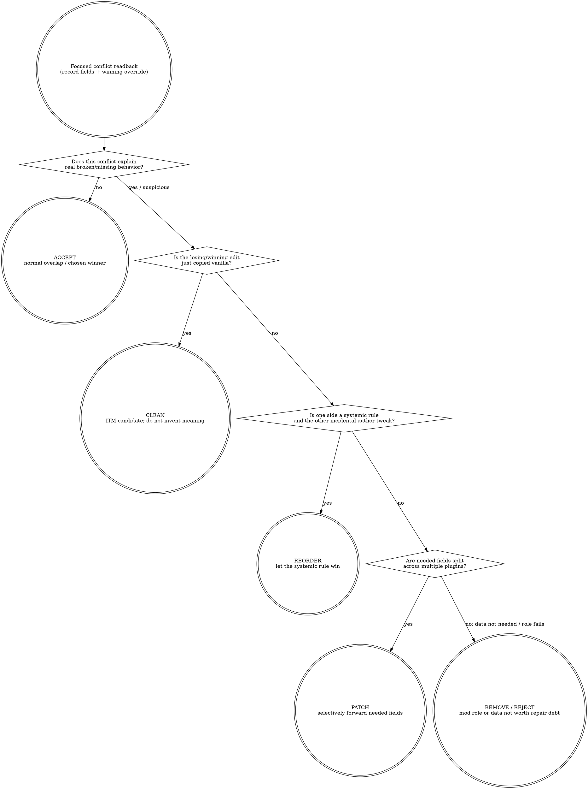

# xEdit Conflict Audit (W2)

Inherits the hub `xedit-automation` skill. Do not restate routing or anti-patterns here; this skill is the W2 workflow only.

## Purpose

For a record or a plugin in scope, produce a verdict: `no_conflict | itpo | itm | minor | breaking`, plus the winning override, the override chain, and a list of plugins that reference the record. Output is a concise summary, not the raw daemon round-trips.

## When To Use

- "Why is this mod's change not showing up?" → audit the affected records.
- "Which plugins overlap on this NPC / weapon / armour / keyword?" → audit by editor ID / form ID.
- "Is this load order safe to ship?" → audit a representative sample of records.

## Tools

Use these MCP intent tools (do not drop to `xedit_call` unless an intent tool does not fit):

- `xedit_session` (always first; once per conversation).
- `xedit_list_capabilities` (once per conversation; sanity-check drift).
- `xedit_find_record` (locate the record(s) you want to audit).
- `xedit_inspect_conflicts` (the verdict tool).
- `xedit_read_record` (when you need to see the actual conflicting field values).
- `xedit_call` for r6-only daemon fields that no intent wrapper exposes yet:
  `records.references`, `records.conflict_status`, and `records.apply_filter`.

If the conflict is broad (many records across many plugins), do not loop through them one by one in the orchestrator — **delegate to a read-only investigator sub-agent** (see Hub skill, "Sub-agent delegation recipes").

## 补丁 vs 改顺序决策 / Patch-vs-reorder decision

This is the judgment gate after the tool surface tells you what wins. xEdit shows the override chain; it does not decide whether the right answer is accept, reorder, clean, remove, or patch. BB84's rule is situational thought over ritual: most overlap is normal, sorting is a single-choice lever, and exhaustive FormID stitching is not realistic at pack scale.

Use this section only to choose the remedy. If the verdict becomes PATCH, stop here and hand off; this W2 skill audits conflicts and names intent, it does not author patch records.



| Decision | Use when | Do not use when |
|---|---|---|
| ACCEPT | The later winner is the intended rule, or the lost edit is not needed for this pack. | You have not read the actual fields; "no crash" is not proof. |
| REORDER | One plugin expresses a broader systemic rule and the other edit is incidental. Let the rule win to reduce patch surface. | Needed fields are split across both sides; order can only choose one winner. |
| PATCH | Multiple plugins carry needed data for the same FormID, and sorting would lose required behavior either way. | You only feel uncomfortable seeing red; most data overlap is normal. |
| CLEAN | The record is an unchanged copy of vanilla / ITM candidate. | You are about to delete a value whose purpose you have not understood. |
| REMOVE / REJECT | The conflict reveals the mod's relevant data is not needed, off-role, or not worth the repair debt. | The source is silent on a hard removal threshold; do not invent one. |

### KB query discipline

This decision section is game-agnostic. Do not inline game-specific xEdit lore,
record-class gotchas, or community patch-position folklore here.

Use KB when the conflict family depends on current game or ecosystem facts:

```text
bgs_kb_query({ query: "xedit patch vs reorder conflict family", domains: ["xedit", "load-order"], games: ["<current game>"] })
```

If KB is silent, mark `[GAP]` instead of inventing a game-specific rule.

### Red flags (STOP)

| Thought | Reality |
|---|---|
| "Red means broken; fix every red cell." | Red means overlapping data. Most overlap is normal; chase behavior-breaking conflicts. |
| "Just reorder until both changes work." | Reordering is a single-choice lever: A wins or B wins. It cannot merge values. |
| "The rightmost value wins, so the rest is irrelevant." | Earlier columns are evidence of lost behavior; read them before deciding. |
| "I'll drag the field directly into the winning mod." | That mutates the source mod and creates cleanup debt. Make a patch if both values are needed. |
| "xEdit can patch everything, so order doesn't matter." | True in principle, impractical at real pack scale. Use order to reduce patch debt. |
| "xEdit shows the conflict, so xEdit alone proves the cause." | Some problems are script-use or presentation mismatches; mark uncertainty instead of guessing. |

### Rationalizations

| Excuse | Reality |
|---|---|
| "Sorting is easier; I'll avoid patches." | Sorting chooses one side. If both sides contain needed fields, you are still dropping data. |
| "I'll patch all conflicts now so future me is safe." | Exhaustive FormID stitching is repair debt. Patch only the conflicts tied to intended behavior. |
| "The later mod is newer, so its override must be intended." | Later means winner, not correct. Compare the field's meaning against the pack's need. |
| "The game boots, so the conflict is acceptable." | Lost fields can silently disable features. Booting is not semantic success. |
| "The field label is obvious enough." | Some data names are abstract. If you do not know the purpose, investigate before forwarding. |

When the verdict is PATCH, route to `xedit-automation` (see its `## 补丁创作判断` section).

## R6 broad-audit shortcuts (capability gated)

Check `xedit_list_capabilities` and branch on `system.capabilities.supports.*`.
Use these r6+ one-call forms when available; old child-by-child and
record-by-record loops remain the fallback for pre-r6 daemons.

### Recursive references (`supports.referencesRecursive`)

For CELL/WRLD/DIAL/QUST targets, prefer:

```text
xedit_call({
  command: "records.references",
  args: { file, formId, recursive: true }
})
```

`recursive: true` unions outgoing references across ChildGroup descendants, so
one call replaces the old "list every ChildGroup child, then reference-probe each
child" loop. Deep reference: `xedit.references-recursive.v1`.

### ChildGroup conflict summary (`supports.conflictStatusChildGroup`)

When `records.conflict_status` returns `result.childGroup`, read that block
before expanding individual records. It summarizes per-signature child-group
state as `{ total, conflicting }` and includes a capped `conflictingHits` array
(cap 20) for the first concrete children to inspect.

This is the broad-audit starting point for CELL/WRLD/DIAL/QUST conflicts:
summarize the `childGroup` block, then deep-read only `conflictingHits` or a
small representative sample. Deep reference: `xedit.conflict-status-childgroup.v1`.

### `apply_filter` regex + `parentFormId` (`supports.applyFilterExtensions`)

Use `records.apply_filter` to collapse broad candidate discovery into a single
server-side query when the daemon advertises `supports.applyFilterExtensions`
(or the narrower `.regex` / `.multiPattern` subkeys, if exposed separately).

- Regex fields: `editorIdRegex`, `displayNameRegex`, `fullNameRegex`,
  `baseEditorIdRegex`, `baseDisplayNameRegex`.
- Regex engine: `System.RegularExpressions.TRegEx`.
- Guardrails: 100ms per-record timeout, 4-worker semaphore, and a
  `RegexSlotsExhausted` response counter so saturation is distinguishable from
  no matches.
- Multi-pattern OR: each `*Pattern` and `*Regex` field may be a scalar string or
  an array with OR semantics; max 32 entries.
- `parentFormId`: single-call ancestor filtering, e.g. "all REFRs whose
  container chain contains CELL X" without building your own parent walk.

Deep reference: `xedit.apply-filter-extensions.v1`.

## Workflow

1. **Bootstrap session.** `xedit_session({})`. Confirm `gameMode`, `consentEnabled` not needed here (read-only), and `loadOrderSize` matches expectation.
2. **Sanity-check capabilities.** `xedit_list_capabilities({})`. Read the `drift.onlyInLive` and `drift.onlyInDigest` arrays plus the r6 support keys. If a target command you intend to use is missing from live, stop and tell the user.
3. **Scope the audit.** Decide whether the audit is per-record, per-plugin, per-signature, or parent-scoped (e.g. all REFRs under a CELL).
4. **Locate records with the narrowest supported query.**
   - Per-record by FormID: `xedit_find_record({ file, formId })`.
   - Per-editor-ID: `xedit_find_record({ editorId })`.
   - Parent-scoped or regex candidate set on r6+: `xedit_call({ command: "records.apply_filter", args: { file?, signature?, parentFormId?, editorIdRegex?, ... } })`.
   - Per-plugin fallback: `xedit_call({ command: "records.list", args: { file, signature? } })`, then iterate or delegate if large.
5. **Inspect conflicts with child-group awareness.** For each focused target, prefer `xedit_inspect_conflicts({ file, formId })`. For broad CELL/WRLD/DIAL/QUST targets on r6+, call `records.conflict_status` through `xedit_call` if you need the raw `result.childGroup` summary; expand only `conflictingHits` or a representative sample instead of probing every child.
6. **Collect references efficiently.** On r6+, `xedit_call({ command: "records.references", args: { file, formId, recursive: true } })` gives a ChildGroup-wide outgoing-reference union. On pre-r6, fall back to the old child walk or delegate the loop.
7. **Classify verdicts.** Read the `verdict` field from the intent tool or map the raw `records.conflict_status` result with the same W2 labels:
   - `no_conflict` → safe.
   - `itpo` / `itm` → likely safe; consider cleaning.
   - `minor` → human review.
   - `breaking` → halt and surface.
8. **For non-trivial verdicts, read the actual record.** `xedit_read_record({ file, formId })`. Compare `record.fields` vs `winningOverride` vs `baseRecord`. Identify the diverging fields.
9. **Summarise.** Produce a short report: one row per record or child-group signature bucket audited, columns `[file, formId, editorId/signature, verdict, winningFile, referencerCount, childGroupConflicts]`. Surface only the breaking/minor verdicts to the user by default; the rest are appendix.

## Verification (what counts as semantic pass)

- The audit's verdict for each spot-checked record matches what manual xEdit GUI inspection would show.
- For breaking verdicts, you have read the actual record fields and can name the diverging fields.
- The output report is concise: one row per record or child-group signature
  bucket, no raw daemon envelopes.
- The session's audit log (`.opencode/artifacts/xedit-mcp/audit/YYYY-MM-DD.jsonl`) contains one entry per MCP tool call you made.

If you cannot meet these for a record, mark it `unknown` in the report and explain why — do not guess.

## Pascal script limitations (BB-84C fork)

**Do not attempt batch conflict scanning with Pascal scripts.** The fork's constrained runtime blocks the following functions that standard xEdit scripts depend on:

| Blocked / unavailable | Result |
|---|---|
| `TStringList.Add` | Runtime policy deny-default — cannot accumulate results |
| `GetTickCount` | Undeclared identifier — cannot implement per-plugin timeouts |
| `ConflictThisForMainRecord` | Undeclared identifier — cannot classify conflict type from Pascal |

Scripts that iterate all records across all plugins will compile but fail at runtime with `deniedIdentifier`, `Undeclared Identifier`, or simply hang. **Use the targeted-sampling workflow below instead.**

## Full-load-order conflict heatmap (targeted sampling)

When the user asks for a broad conflict overview ("全量冲突扫描"), DO NOT attempt a Pascal script or iterate every record. Use this 4-phase targeted-sampling workflow:

### Phase 1: Parse the load order

1. Call `xedit_call files.list` to get all 934 plugin names, load orders, and flags.
2. Parse the response with Python (`execute_code`) to:
   - Strip the 5 core ESMs (Skyrim, Update, Dawnguard, HearthFires, Dragonborn).
   - Extract the last 60 plugins as the "winner zone."
   - Group plugins by conflict-prone category keywords: `Vampire`, `Sacrosanct`, `Water`, `Lux`, `NPC`, `OStim`, `Animation`, `Combat`, `UBE`, `Appearance`, `ENB`.

### Phase 2: Identify high-override records per zone

For each category's last-loading plugin (the winner), call `records.list` with the relevant signature:

| Category | Signature(s) to probe |
|---|---|
| Water / ENB | `WATR` |
| Vampire / Sacrosanct | `SPEL`, `PERK`, `RACE` |
| NPC overhauls | `NPC_` |
| Quests / Alternate Start | `QUST` |
| DynDOLOD / worldspace | `WRLD` |
| Combat / perks | `PERK` |

In the response, scan for records where `overrideCount > 0` — these are the conflict candidates.

### Phase 3: Deep-inspect conflict candidates

For records with `overrideCount ≥ 2` (or at least the top 3–5 per zone), call `xedit_inspect_conflicts`. This returns the verdict, the full participant chain, and the winning override — all in one call.

### Phase 4: Classify and report

| Verdict pattern | Meaning | Action |
|---|---|---|
| Internal patch chain (base → patch1 → patch2, same family) | Intentional, `minor` | Report as 🟢 normal |
| External unrelated override | Potential problem | Flag as 🟡 and read `xedit_read_record` |
| `breaking` | Real conflict | 🔴 Halt and surface |

The final report uses the same 4-tier structure as the file-based pre-audit (🔴/🟡/🔵/🟢) but with xEdit record-level evidence. See `references/targeted-sampling-example.md` for a worked example from the pbr profile.

## Common Mistakes

- Calling `xedit_call records.conflict_status` directly when `xedit_inspect_conflicts` would do it with the verdict label already mapped; use raw `records.conflict_status` only when you need r6 response blocks such as `result.childGroup`.
- Treating `no_conflict` as proof of safety without reading at least one representative record.
- Looping through hundreds of records in the orchestrator's context when r6 `recursive`, `childGroup`, `apply_filter`, or delegation would collapse the work.
- Forgetting to call `xedit_session` first; downstream tools will refuse with `state_violation`.
- Asking the daemon for a file that is not in the load order; `LOAD001` will fire — load it via the session first.

### Pitfall: MCP server crash on large WRLD `conflict_status` responses

**Symptom**: calling `records.conflict_status` on a major worldspace (e.g. Skyrim
Tamriel `0000003C`) returns a massive response — the `childGroup` block can
contain 325K+ child records with per-signature conflict counts. The MCP server
may crash (become unreachable) after processing this response. The daemon
process survives (`xedit_status` still reports `ready`) but the MCP transport
drops.

**Root cause**: the response payload for a worldspace with 934 active plugins is
extremely large (the participants list alone can have 153 entries, plus
per-element conflict data). The MCP server's Node.js process may exhaust memory
or hit a transport buffer limit.

**Prevention — do NOT audit WRLDs with `conflict_status` on large load orders**:

Instead, use this progressive approach:

1. **Read the `childGroup` summary only** — the `childGroup.signatures` block gives
   per-signature totals and conflicting counts without per-record data. This is
   compact and survives large worldspaces.
   ```text
   CELL: 11,187 total / 5,710 conflicting
   REFR: 284,482 total / 37,792 conflicting
   LAND: 11,188 total / 3,227 conflicting
   ```
2. **Target specific plugins** — use `records.list` on individual plugins of
   interest (Landscape Fixes, Water for ENB, DynDOLOD) rather than filtering the
   entire worldspace.
3. **Use `xedit_inspect_conflicts` per-record** — once you have specific
   FormIDs from `records.list`, inspect them one at a time. Each call is small
   and safe.
4. **For broad surveys, delegate** — spawn a read-only investigator sub-agent
   to iterate through a bounded set of plugins, collecting per-plugin conflict
   summaries.

**Recovery**: if the MCP crashes, wait ~50s for the auto-retry cooldown, then
reconnect. The daemon stays alive through the crash. No restart needed —
just resume with `xedit_session`.
- **Attempting Pascal batch scripts for conflict scanning** — the fork's runtime blocks `TStringList`, `GetTickCount`, and `ConflictThisForMainRecord`. Use the targeted-sampling workflow instead.
- **Assuming xEdit won't launch without MO2 running** — it can (this session launched successfully with MO2 closed). The VFS may not be mounted, but the daemon will start and load whatever it can see. Check `loadOrderSize` against `plugins_enabled` from `mo2_status` to confirm.

## Asset-level conflict analysis (NIF/mesh)

Plugin-record conflicts are only half the picture. The load order also
determines which mod's loose NIF file wins for any given virtual mesh path.
When investigating in-game visual bugs (wrong mesh, missing textures, PBR
upgrade artifacts), also audit the asset layer:

1. `mo2_assets_conflicts({ profile, path_prefix: "meshes/..." })` — file-level
   NIF winners and losers.
2. `mo2_assets_resolve({ profile, virtual_path })` — single-path resolution.
3. Binary block-structure comparison and texture-reference extraction —
   detailed recipe in `references/nif-asset-conflict-analysis.md`.

This is complementary to record-level conflict auditing; the same
patch-vs-reorder judgment applies: if the winning NIF is intentional (PBR
upgrade, BodySlide output, variant selection), accept it. Only escalate when
the winning NIF is structurally degraded (missing bones, lost collision).

## Fallback: When xEdit MCP Is Unavailable

When the xEdit daemon cannot launch (MO2 broker offline, VFS transport broken, dual-plugin conflict), do NOT loop indefinitely retrying the launch. Switch to a **file-based pre-audit** that identifies high-risk conflict zones from `plugins.txt` and `loadorder.txt` alone.

### Phase A: MO2 MCP surface (always available, no xEdit needed)

These MO2 MCP tools work without MO2 running and without xEdit:

1. **`mo2_session`** — bind to the target MO2 root. If the user says "分析 <PATH_TO_MO2_INSTANCE> 的冲突", bind there first.
2. **`mo2_status`** — get game, profile name, mod/plugin counts, and MO2 running state. The `profile` field tells you WHICH profile to query — don't assume "Default".
3. **`mo2_pluginlist({ profile, enrich: true })`** — get the full enabled/disabled plugin list with load-order metadata. The `_meta` block explains precedence direction.
4. **`mo2_assets_conflicts({ profile })`** — file-level VFS conflicts (textures, meshes, scripts). A zero-count result means asset precedence is clean.
5. **`mo2_mod_info({ name })`** — check individual mod state. Critical for the "installed but not activated" cross-reference check (see below).
6. **`mo2_plugin_warnings()`** — live-only (requires MO2 running), but try it; if it fails with `live_broker_required`, note it and continue.

### Phase B: Direct plugins.txt analysis (shell grep)

When `plugins.txt` is large (800+ entries), use direct shell grepping to avoid truncation. Full command patterns live in `references/file-based-pre-audit-commands.md`.

Core analysis passes:

1. **Basic counts** — `grep -c '^\*' plugins.txt` (enabled) and `grep -c '^[^*#]' plugins.txt` (disabled). Also `grep -n '^[^*#]' plugins.txt` to list disabled with line numbers.
2. **Category hotspot scan** — Run a multi-grep per conflict domain. Target categories: Vampire/Sacrosanct, Water/Water for ENB, Lighting/Lux, NPC overhauls, Animation/Combat, OStim, Appearance/UBE. For each category, `grep -i "<keywords>" plugins.txt | tail -10` shows the last-loading (winning) plugins.
3. **Winner-zone dump** — `grep '^\*' plugins.txt | tail -30 | nl -v <N>` where N = total_enabled - 29. This is the final 30 winner plugins. Categorize them by domain; flag overlapping categories.
4. **Installed-but-not-activated check** — For major mods known to be in the pack (Lux, USSEP, DynDOLOD), verify they appear in plugins.txt. If a mod's folder exists under `mods/` but its plugin is missing from `plugins.txt`, flag as 🔴 CRITICAL. Use `mo2_mod_info` to confirm folder existence, then `grep` plugins.txt for the plugin name.
5. **Order anomaly scan** — For key plugins (NAT-ENB, weather mods), check their line number. If a weather/lighting mod loads in the first 30% of the order, flag as 🟡 potential override issue.

### Phase C: Cross-reference disabled plugins against enabled patches

For each disabled plugin, check whether enabled patches have it as a master:

```bash
# List all disabled with line numbers
grep -n '^[^*#]' plugins.txt
```

Risk assessment per disabled plugin:
- **🔴 CRITICAL**: A disabled plugin is a master for an enabled patch → CTD on load.
- **🟡 HIGH**: Disabled compatibility patch between two enabled mods → missing behavior.
- **🟢 LOW**: Standalone feature mod disabled → no downstream impact.

### Phase D: Structured report

Produce a report with four severity tiers:

| Tier | Label | Criteria |
|---|---|---|
| 🔴 | CRITICAL | CTD risk, missing master, core mod completely absent |
| 🟡 | HIGH | Wrong load order position, disabled patch between active mods, potential override loss |
| 🔵 | INFO | Category overlap analysis, winner-zone structure validation |
| 🟢 | LOW | Standalone disabled plugins, cosmetic-only issues |

Report sections (in order):
1. Basic statistics table (mod count, plugin count, profile, game)
2. 🔴 CRITICAL findings (always first)
3. 🟡 HIGH findings
4. 🔵 Winner-zone analysis (last 30 plugins, categorized)
5. 🔵 Disabled plugin inventory with risk levels
6. 🔵 File-level asset conflict summary
7. 🟢 Action recommendations (priority-sorted)

All verdicts are `[FILE-ONLY]` until xEdit record-level audit runs. List the specific plugins to deep-audit once xEdit MCP is available.

### Pitfalls

- **Profile mismatch**: `mo2_status` and `mo2_pluginlist` may return different profiles if you don't pass `profile` explicitly. Always read `mo2_status` first to get the active profile name, then pass it to all subsequent calls.
- **MO2 Default profile ≠ active profile**: The MO2 session binds to a root, not a profile. The active profile is read from `ModOrganizer.ini` and may differ from "Default".
- **xEdit can launch without MO2 running**: The xEdit MCP daemon CAN start even when the MO2 broker is offline. This session launched xEdit with MO2 closed and the daemon reached `ready` state with 934 files. However, plugins may not all be visible without VFS — cross-check `xedit_session.loadOrderSize` against `mo2_status.counts.plugins_enabled`. If they differ significantly, some plugins are missing from the virtual tree.
- **`read_file` line-number prefix**: The `read_file` tool prepends `NNN|` to each line. Strip it before parsing: `line[line.index("|")+1:]`.
- **No `Lux.esp` in plugins.txt doesn't mean Lux isn't installed**: Always cross-reference `mo2_mod_info` against plugin presence. The mod folder exists but the plugin may be unchecked in MO2.

See `references/file-based-pre-audit-commands.md` for the full set of shell command patterns and category keyword tables.

See also: `using-bgs-modding-superpowers` → `references/mo2-troubleshooting.md` for common xEdit launch failures and their fixes.

## Delegation hints

This workflow is a strong candidate for read-only sub-agent delegation in two cases:

1. **Large scope** (> ~10 records to audit) — the round-trips will fill the orchestrator's context. Delegate the loop; receive the per-record summary table.
2. **Exploratory diagnosis** ("I don't know which record is causing this in-game issue") — let a sub-agent triangulate by editor ID and signature; you'll get the candidates back.

When delegating, include this skill and the hub skill in the sub-agent's prompt and provide the scope + budget.

## Multi-type audit pattern

For comprehensive conflict surveys spanning multiple record types (NPC_/LVLI/KYWD/CELL/WRLD),
see `references/multi-type-conflict-audit-pattern.md` for the proven progressive-layered
approach that avoids MCP crashes on large load orders.
